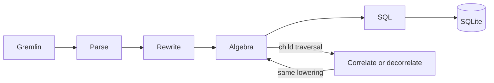
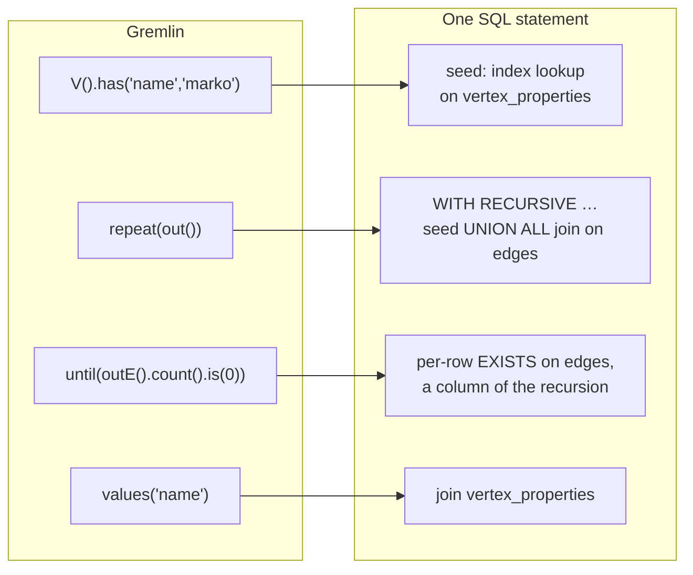
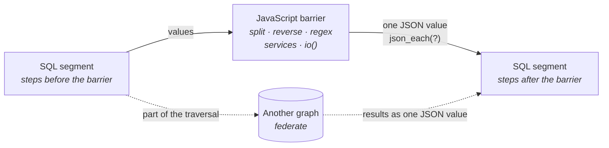

<p align="center">
  
</p>

# mogwai-db

**A TinkerPop 4 graph database that uses SQLite as its engine. It runs in the browser, at the edge,
as a single binary and in Docker.**

Connect any TinkerPop 4 client. The client sends Gremlin over the standard HTTP protocol. You do not
need a special driver. mogwai-db compiles each query to SQL, and SQLite runs it.

> ### Status: pre-alpha — not for production
>
> We develop on `trunk` in the open. There is no authentication yet, and the API can change.
>
> - **Parses the whole language.** All 2,395 / 2,395 standard Gremlin traversals parse. The parser
>   is generated from TinkerPop's own `Gremlin.g4` grammar.
> - **Gives correct answers.** **<!-- L3:passing -->2,059<!-- /L3:passing --> / <!-- L3:ceiling -->2,246<!-- /L3:ceiling -->**
>   official TinkerPop test scenarios pass. They run through the unmodified `gremlin` JavaScript
>   client over the real GraphBinary protocol. The pass count can only go up.
>   The second number is the ceiling: the <!-- L3:in-scope -->2,270<!-- /L3:in-scope --> in-scope
>   scenarios, less the ones we will not pass by design
>   ([limitations](docs/limitations.md)).
> - **Reads, writes and strategies** are supported across most steps. See the
>   **[feature support matrix](docs/feature-support-matrix.md)**.

## Try it now

Open **[bodar.github.io/mogwai-db](https://bodar.github.io/mogwai-db/)**. The whole database runs
in your browser tab, with no server and no install. The page is the interactive API reference: pick
a request, edit the Gremlin, and send it.

## Quick start

1. Start a server with Docker:

   ```sh
   docker run -p 8182:8182 -v data:/data ghcr.io/bodar/mogwai-db:latest
   ```

2. Send a query. A graph is created the first time you use its name:

   ```sh
   curl -X POST localhost:8182/gremlin/demo -d '{"gremlin":"g.addV(\"person\").property(\"name\",\"ada\")"}'
   curl -X POST localhost:8182/gremlin/demo -d '{"gremlin":"g.V().values(\"name\")"}'
   ```

3. Or point a TinkerPop 4 client (any language) at `http://localhost:8182/gremlin/demo`.

## Install

Every edition is self-contained. Each release publishes all of them
([Releases](../../releases)).

| Edition | How to run |
|---|---|
| **Docker** | `docker run -p 8182:8182 -v data:/data ghcr.io/bodar/mogwai-db:latest` (multi-arch). |
| **Binary** | Download `mogwai-db-<version>-<os>-<arch>` (Linux, macOS, Windows; arm64 and amd64). Run `./mogwai-db --data-dir ./graphs`. It serves on port 8182. Use `--help` for options. |
| **Cloudflare Durable Objects** | Unzip `mogwai-db-<version>-cloudflare.zip`. Set `CLOUDFLARE_API_TOKEN`. Run `./deploy.sh`. One Durable Object holds one graph. |
| **Browser** | Unzip `mogwai-db-<version>-browser.zip` into a static folder. Add `<script type="module" src="mogwai-db.js">`. SQLite runs as WebAssembly behind a Service Worker, so the database lives in the browser tab with no server. A TinkerPop client or a plain `fetch` works. |

All editions share the same parser, compiler and wire code. Only the SQLite layer changes. One
contract test runs against every edition over the real wire.

## Use the API

| Request | Effect |
|---|---|
| `POST /gremlin/{graph}` with `{"gremlin": "…", "bindings": {…}}` | Runs a query. |
| `PUT /gremlin/{graph}` | Creates a graph. |
| `GET /gremlin/{graph}` | Describes a graph. |
| `DELETE /gremlin/{graph}` | Deletes a graph. |
| `GET /openapi.json` | The OpenAPI 3.1 description of the API. |
| `GET /docs` | Interactive API reference. |

Because the API describes itself, an agent can use it with no custom code. For example, an MCP
server can wrap the OpenAPI description.

## Why it is different: compiled, not interpreted

TinkerPop's reference engine is an interpreter: each step pulls traversers from the step before it.
Several graph databases (for example
[Neptune](https://docs.aws.amazon.com/neptune/latest/userguide/gremlin-step-support.html),
JanusGraph and Sqlg) run some steps natively, such as an index lookup for `has()`, and hand the rest
to that interpreter. Nesting can change this: Neptune, for example, does not convert `order()` or
`aggregate()` inside a child traversal.

mogwai-db has no interpreter to fall back to. It compiles the whole traversal, at any depth, to SQL,
and SQLite runs it in the same process as the data. SQLite does the planning, the index lookups and
the execution. A query that mogwai-db cannot compile fails with a clear error.

The rest of this section shows how.

### The engine



1. **Front end.** A parser generated from TinkerPop's grammar reads the query into a chain of
   steps. Rewrite rules then apply TinkerPop's strategies (for example `PartitionStrategy`) and
   simplify the chain.
2. **Relational algebra.** Each step becomes relational operators. A movement step is a join on the
   edge table. `repeat()` is a recursive union. `group()` is an aggregate. `order().limit()` for each parent row
   is a window.
3. **Nesting at any depth.** Many steps take a child traversal: `where`, `map`, `local`,
   `project().by()`, `union`, `choose`, `coalesce` and more. The engine lowers the child's body with
   the same code that lowers the main traversal, so every supported step also works inside any
   child, at any depth. It then connects the child to its parent row in one of two ways:
   - If an index can answer the child for each parent row, it stays a correlated subquery
     (`EXISTS`, or a lookup of the first row). SQLite has no hash join, so an index lookup is the
     fast form.
   - Otherwise the engine **decorrelates** it. The child becomes an ordinary join, grouped by the
     parent row. This is the general unnesting method of Neumann and Kemper (*Unnesting Arbitrary
     Queries*, 2015), which Apache Calcite also uses. It is one rule per operator, not one special
     case per query shape.
4. **SQL.** The algebra prints as one SQL statement for a read. A write runs as a short, fixed
   sequence of statements. The number of statements depends on the query, never on the number of
   rows.

### An example

`g.V().has('name','marko').repeat(out()).until(outE().count().is(0)).values('name')` returns the
names at the end of every path from `marko`. Each step maps to one part of a single SQL statement:



The `until()` condition is a child traversal. It runs once per row inside the recursion, as an index
lookup.

### When SQL is not enough: JavaScript and other graphs

Some steps have no SQL form, for example `split()`, `reverse()` or a JavaScript `regex`. Some work
happens outside the database: a `call()` service, `io()` import and export, or a query on another
graph. For these, the engine cuts the plan into **segments** at a **barrier**:



- The SQL segment before the barrier reads all the values in one batch.
- JavaScript transforms the whole batch at once, not one row at a time.
- The result goes back to SQLite as **one** JSON value, which `json_each` opens as a table. The next
  SQL segment joins it like any other table, so the rest of the traversal stays compiled.
- **Federation** sends part of a traversal to another graph. The other graph runs it as its own
  compiled query. The results come back as one JSON value in the same way.

This is also the extension point. A new service or a new value transform plugs in as a barrier,
and the steps around it stay SQL.

Each graph-algorithm service (PageRank, connected components, and the others) runs as set-based SQL
too. A query that the engine cannot compile fails with a clear `UnsupportedTraversal` error. It never
falls back to a slow path or gives a partial answer.

## When to use it

mogwai-db is for **many small or medium graphs**, each kept close to the code that uses it. Examples:
a knowledge graph per user, a graph per SaaS tenant, agent memory, a graph inside an app. Each graph
is one SQLite database, so graphs are isolated from each other. On Cloudflare, a graph that is not
in use costs almost nothing.

**Do not use it** for one very large graph or for analytics at large scale. One graph is one SQLite
file or one Durable Object (about 10 GB on Cloudflare), and each graph runs on one thread. The graph
algorithms are included — PageRank, ArticleRank, HITS, degree, betweenness and closeness centrality,
weakly and strongly connected components, peer-pressure clustering, k-core, node similarity,
triangle count and shortest path — but they run on one graph at a time, not across a cluster.

The mogwai-db column is a self-rating: ✅✅ = a strength, ✅ = on par, ❌ = a weakness for now.

| Property | mogwai-db | Neptune | Cosmos (Gremlin) | Neo4j | TigerGraph |
|---|---|---|---|---|---|
| Gremlin / TinkerPop | ✅✅ **v4** | v3 | v3 | Cypher | GSQL |
| Runs | ✅✅ browser · edge · binary · Docker | managed only | managed only | self-host · managed | self-host · managed |
| Scale to zero | ✅✅ ~$0 when idle | no | no | no | no |
| Many small tenant graphs | ✅✅ free | costly | costly | costly | costly |
| Size of one graph | ❌ ~10 GB | ~unbounded | ~unbounded | large | large |
| Graph algorithms | ✅ growing library | strong | weak | strong | strong |
| Maturity | ❌ **pre-alpha** | GA | GA | GA | GA |

The size limit is part of the design: one SQLite database, one thread per graph.

## Documentation

| Document | Use it to |
|---|---|
| [Feature support matrix](docs/feature-support-matrix.md) | Look up a Gremlin step and see if it is supported. |
| [Limitations](docs/limitations.md) | See what we will not build, the number limits, and where answers differ from Java TinkerPop. |
| [Outstanding work](docs/outstanding-work.md) | See known bugs and planned work. |
| `GET /docs` on a running server | Look up the HTTP API. |

## Develop

The toolchain is pinned with [mise](https://mise.jdx.dev). Run `mise install`, then `mise run test`
or `mise run ci` (the full gate). The first run downloads the pinned TinkerPop submodule (grammar,
test scenarios and the JavaScript test runner) and starts the Cloudflare edition under
`wrangler dev`, so it can take some time. All work lands on `trunk`. Contributions are welcome.

## The name

*Mogwai* (魔怪) is Cantonese for a small, mischievous devil — a good name for a small graph database
that speaks **Gremlin**, the TinkerPop query language.
